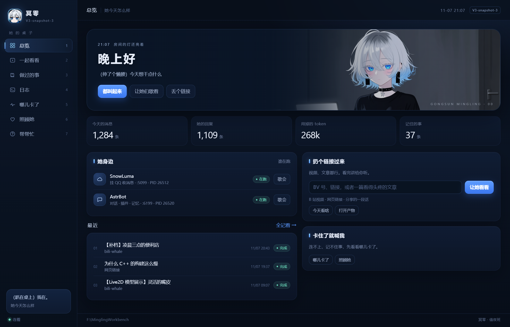

<div align="center">

# 冥零工作台


一个 `MinglingWorkbench.exe`，把「QQ 聊天机器人」和「B 站看片」收进同一个窗口：
起停 SnowLuma / AstrBot、跑八块自设定、看今天的选题、丢一个 BV 进去让它自己看完、翻任务台账和日志。

**C++ 后端 + WebView2 内嵌 HTML**。七个页面和角色图片编进 exe，离线加载，不启动本机网页服务器。
界面以冥零的冷白、雾蓝、宝石蓝和现有立绘重做成「她值夜班时的桌子」。

当前正式版：**V3.2.0**。运行需要 Microsoft Edge WebView2 Runtime，`WebView2Loader.dll` 随程序分发。
[HTML 界面开发与验收](docs/ui-html.md)

[下载安装包](#-下载与使用) · [从源码编译](#-从源码编译) · [使用说明](docs/使用说明.md) · [变更记录](docs/CHANGES.md)

</div>

---

## 📖 项目简介

冥零工作台是一个**给单机机器人用的控制面板**，不是云端服务，也不依赖任何外部 IDE 或平台。

- **一切都在本机**：C++ 源码 + 一个只在本机跑的 Node sidecar。不登录、不上报、不收集数据。
- **一个 exe 管两件事**：左边管机器人（起停服务、看状态、修问题、导人设），右边管 B 站（选题、看完、出九宫格/字幕条/正文）。
- **内嵌 HTML 界面**：WebView2 加载 exe 内的 HTML/CSS/JS 和角色图片，C++ 负责本机状态、配置和任务。页面不依赖 CDN，也不开放本机 HTTP 端口。
- **不重造轮子**：B 站协议、wbi 签名、抽帧、字幕识别留在 sidecar 里（一个 Node CLI，MIT 许可），
  窗口只负责「给参数、读进度、展示结果、写台账」。上游修了 bug 换 sidecar 即可，不用重编 UI。

技术栈：C++17 / Win32 / WebView2（内嵌 HTML）/ GDI+ / WinHTTP，MinGW-w64 静态链接，Inno Setup 6 打包。

---

## ✨ 核心特性

### V3.2.0 新增

- **SnowLuma 可以打进安装包**：出包时加 `installer\build-installer.bat -BundleSnowLuma`（离线再加 `-Offline`），
  上游官方原版 zip 会放进 `{app}\pack\snowluma\`，装完不用再联网下 41 MB。内置版的产物名带后缀
  `MinglingWorkbench-3.2.0-setup-snowluma.exe`，和正式发布的 `MinglingWorkbench-3.2.0-setup.exe` 分开，
  不会再互相覆盖。默认**不内置**——上游 EULA §5.4 要求并入第三方安装包须先取得书面授权，这条通道只显式开启，
  谁开启谁负责（[docs/snowluma.md](docs/snowluma.md) 第 14 节、[docs/THIRD-PARTY.md](docs/THIRD-PARTY.md) 第 4 节）。
- **装包自带的组件包优先**：程序目录下 `pack\<组件id>\` 里只要有 sha256 对得上的文件就直接用它，
  不下载、不联网，`-Offline` 下同样有效。匹配按清单里的 sha256 判定而不是文件名，上游改名也不会失效；
  日志对应一行「用装包自带的 `<文件名>`（不用下载）」。
- **SnowLuma 原理写清楚了**：新增 [docs/snowluma.md](docs/snowluma.md)，16 节，讲它是 Hook / 注入路线
  （真正的桌面 QQ 先登录，再向进程注入 `native\snowluma-win32-x64.dll`，走 `\\.\pipe\mojo.<pid>.control|recv`
  匿名管道拿下会话，对外再说 OneBot 11），不是协议模拟；含启动时序逐段拆解、`onebot_<号>.json` 的
  `overlay` / `snapshot` 两种模式、WebUI 五页、密码与协议同意机制、排查表。
- **界面的可用性和主题一致性**：左侧页签与子列表能用 Tab / 方向键 / Enter / Space 操作，重绘后焦点不丢；
  编辑弹窗有焦点陷阱，Esc 关闭后回焦到触发元素。日志和检查结果贴底跟随，往上翻不被拽回去；
  toast 宽度上限提到 `min(80vw, 720px)` 并保留换行，带路径和错误码的报错不再被截断。
  失败类提示留 **12 秒**（正常提示 4 秒），不再一闪而过。白天 / 自定义主题补齐了漏色，宽屏内容区 1260 → 1320px。

### V3.1.0 新增

> 上一版加的东西，还在。

- **她会做的事多了三样**：唱歌、桌宠、豆包语音。豆包语音和在线 Breeze 的凭据填在配置界面里，
  存本机、不回显密钥，留空就保留原值。
- **唱歌可以选择云端或本地**：豆包云端、SoulX 本地二选一，配置覆盖分别保存，自设定不会把本地选择
  覆盖回豆包。本地那条链路包括部署、启动、健康检查和生成试听，独立 Python / CUDA 环境适配 RTX 50 系列，
  下载可重试、模型保留。
- **本地唱歌可以借她自己的声音**：用已有冥零参考，或者拿已保存的 Breeze 音色做参考——自动生成中文时间
  与音高标注，先备份再热加载。
- **桌宠配置**：最近消息范围、提醒转发、连接检测。接通走 V3 自设定接口，不会删掉已有聊天会话。
- **安装与环境自动化收成一套**：`tools\components.json`（21 个组件的声明式清单）+ `tools\bootstrap.ps1`
  （检测 → 安装 → 验证，按 `requires` 拓扑排序）。工作台「一键自动配置」/`--autosetup`/`--bots-setup`、
  安装器、`mingling-install` 技能、旧的 `auto-setup.ps1`（现在只是个转发壳）全都指向它，不再各写一套下载逻辑。
- **下载可信、失败可退**：统一校验 SHA256，GitHub / npm / pip / uv 走镜像并自动回退；`-Check` 只检测、
  `-Offline` 只吃校验过的缓存、`-Proxy` 支持代理。状态写 `<工作区>\logs\setup\state.json`，
  日志逐行脱敏（Key、Token、QQ 号）。
- **八块自设定多了只读 `-Verify`**：不 PUT、不拍快照、不写文件，和 `-Apply` / `-DryRun` 互斥；
  敏感项只从 `secrets\`（兼容旧的 `private\`）读。
- **安装包自带清单**：包里有 `tools\components.json`，装完跑一次 `bootstrap.ps1 -Check` 留证据。
  自更新把当前工作区作为 `/WORKSPACE` 传给安装包，收尾体检不会再查错目录。
- **修了一批真会挡住人的问题**：服务状态不再仅凭端口误报、配置损坏不再被覆盖、备份不再重名、
  PowerShell 的 CUDA 探针引号导致验证没执行、首装装成 `.new.exe`、安装包往受保护目录写日志。

### V3 线打底那批改动

> 下面这些是 V3 线一开始就有的，不是这一版新增。

- 七页界面整个换成内嵌 HTML（WebView2）：页面、样式和角色图片直接打进 exe，走内存资源离线加载，
  不开本机端口。主题叫「她值夜班时的桌子」——深夜蓝底、冰蓝高光，总览放她的立绘，侧栏是她的头像和说话框。
- 启动先铺一层与主题同色的加载画面，WebView2 初始化期间不再闪出旧界面；只有初始化或页面加载明确失败，
  才退回原生界面并恢复系统窗口控制。
- 文案按 `冥零人设.md` 重写：短句、括号动作、不客服腔；页名换成她的说法——总览 / 一起看看 /
  做过的事 / 日志 / 哪儿卡了 / 照顾她 / 帮帮忙，状态、数字和报错原因照实写。
- 阅读记忆队列 `memory-inbox`：看完的 B 站视频、读过的网页和「问一句」的回复，先在工作区
  `logs\memory-inbox\` 排队，再由 `astrbot_plugin_bili_bridge` 0.3.0 每 30 秒挑走写进她的长期记忆；
  失败留着重试，退出或取消也不丢。队列状态在「照顾她」→「她会做的事」→ 长期记忆下面看。
- 黑夜 / 白天 / 自定义三套主题：黑夜保留深蓝，白天换成瓷白配蓝，自定义能改背景 / 卡片 / 文字 /
  强调色四个颜色，切完自动保存、重启还在；标题栏跟着主题一起刷（DWM），不再一黑一白。
- 「照顾她」拆成四个分区 tab：组件与操作 / 相处的习惯 / 她会做的事 / 外观主题，
  各分区独立渲染，切过去即时重绘，主题脏标记也按分区清。
- 「做过的事」改成双栏：左栏「本子」是任务列表，右栏「这一次」常驻选中任务的详情和正文，
  不用先展开才看得到；没选中时给一句空态提示。
- B 站桥接插件 `astrbot_plugin_bili_bridge` 升到 0.3.0：群里发 B 站链接 → 工作台看片 → 用她自己的口气回话。

### 从 V2.4.1 到 V3：其它改动

| 功能 | 说明 |
| --- | --- |
| **链接读取落地** | 输入框统一入口：BV / B 站链接 → 看片；普通网页链接、分享文本 → 读链接。结果区统一给标题、摘要、来源、耗时、状态，可以复制、可以「问一句」、会写台账（`type:"link"`）。读链接跟随重定向、自动解 gzip、认得 GBK，失败原因说人话（超时 / 不是 http / 编码 / 太大 / 被拒）。 |
| **「链接与应用」配置** | 「一起看看」→ 配置 → 链接与应用：读取开关、超时（上限 15 秒）、大小上限（上限 512 KB）、User-Agent；对话 API 的启用 / Base URL / 路径 / 模型 / 超时 / Key，带「测试连接」。默认值一点没放宽：单次 GET、15 秒、512 KB。Key 只写 `secrets\dsh-api-key.txt`，不进 `settings.json`、不进日志。 |
| **B 站页并成四个分区** | 选题 / 看片与读链接 / 结果 / 配置。原来的「bili-whale 配置」和「问一句」两个浮层都搬进页面里，不再是浮层。 |
| **更新只覆盖工作台自己** | 帮帮忙 → 检查更新 → 工作台行「一键更新」：下载安装包 → 校验大小 / 哈希 → 先把 `bin\ sidecar\ tools\ pack\ plugin\ skill\ docs\ art\` 备份到 `<机器人根>\旧版\workbench-<版本>-<时间>\` → 静默覆盖安装 → 重启。`bots\`、`out\`、`logs\`、`secrets\`、`private\` 和 `%APPDATA%` 下的设置一概不碰；装失败自动回滚到备份。 |
| **教程随包、离线可读** | `docs\使用说明.md`、`docs\deploy-bili.md`、`docs\deploy-qq.md` 跟着安装包走，帮帮忙 → 教程里直接读（标题 / 列表 / 代码块 / 表格都渲染），还能「用系统打开」。文档里的版本号、页签数、快捷键由程序注入，不写死。 |
| **十页并成七页** | 侧栏收成 总览 / 一起看看 / 做过的事 / 日志 / 哪儿卡了 / 照顾她 / 帮帮忙；功能开关收进「照顾她」，更新、求助、教程并进帮帮忙。 |
| **界面按人设重做** | 颜色、圆角、间距、字号收进一组 CSS 变量（`win32\web\index.html` 顶部），卡片统一走同一个模板函数；空状态和报错用冥零的口吻，但原因不吞。 |

### V2.4.0 新增（正式版）

| 功能 | 说明 |
| --- | --- |
| **安装包自带安装 Skill** | `skill\mingling-install\` 跟着安装包走（SKILL.md、版本号、`scripts\probe.ps1` 体检脚本、`scripts\finish.ps1` 收尾、两份 references）。第一次启动会自动铺到 `%USERPROFILE%\.agents\skills\mingling-install`，并写下 `<机器人根>\tools\skill-home.txt`（装在哪一份）和 `tools\skill-version.json`（哪一版）。本机已经装过更新的一版就不覆盖；确实要替换时先把旧的备份到 `<机器人根>\旧版\`。 |
| **更新页认冥零自己的 Skill** | 第四项从 `dafeiyu-install` 换成 `mingling-install`：本地版本读 `tools\skill-version.json`（没写就读 `skill-home.txt` 指的那份 `version.json`）；私有仓库的版本清单走 `api.github.com/…/contents/…` 带 token 查，连不上时只说「查不到」，不再误报「还没发布」。正式版只查正式通道、快照版才查快照通道；点「更新技能」会带 token 从 release 资产下 `mingling-install.zip`，失败再退回加速站。 |
| **安装包补齐运行时要用的东西** | 以前的包只打了 exe / sidecar / art / docs，干净机器装完点「自设定」只会说「没找到 tools\self-setup.ps1」。V2.4.0 补上 `tools\`（自设定、一键配置、体检、备份、重登、掉线提醒的脚本，以及 `tools\python\` 运行时）、`pack\mingling-pack\`（八块配置清单）、`plugin\mingling_skill\`（人设注入要读的清单）。装完不求人，直接跑八块自设定。 |
| **组件路径全面认 `<工作区>\bots\`** | 起停服务、日志页（AstrBot / SnowLuma 两路）、体检脚本（`tools\diag.ps1` + `common.ps1`）、备份、重登 QQ、掉线提醒，全都先找 `<工作区>\bots\<名字>`，找不到才退回老平铺目录；B 站那页只剩旧版留下的 `logs\bili-service.log` 时会明说「这是旧版的历史内容，bili-whale 现在不写常驻日志」。 |
| **exe 属性不再是乱码** | `windres` 补上 `-c 65001`，版本资源里的中文按 UTF-8 读，属性页看到的「冥零工作台」不再是 `鍐ラ浂宸ヤ綔鍙?`。 |

### V2.2.0 新增

| 功能 | 说明 |
| --- | --- |
| **一键配置环境** | 照顾她页「一键自动配置」（或 `MinglingWorkbench.exe --bots-setup`）自动补 Node / ffmpeg / Python / Ollama，并把 AstrBot、SnowLuma、Breeze、Ollama、bili-whale **五个组件**装进 `<组件根>\<名字>\`，生成 `start-all.cmd` 与 `.setup.json` 安装报告。也可以脱离界面跑 `tools\auto-setup.ps1 -Workspace … -Bots … -Base …`。 |
| **冥零的人设模板** | `plugin\mingling_skill\` 带人设正文与 AstrBot Skill 描述（**不是**上面那个「安装 Skill」，那是给 Agent 装/修工作台用的说明书）；照顾她页「导入冥零人设」把人设写进 AstrBot 的 `personas` 表、切好 `persona_id`、顺手改白名单前缀，并同步给桌宠。想换成自己的角色，只改 `{user_persona}` / `{user_tone}` 两段。 |
| **掉线提醒** | 后台心跳默认每分钟探一次 SnowLuma（5099）、AstrBot（6199）、Breeze（8137）；连**续两次**失败才算掉线，同一条 10 分钟内只提醒一次。提醒是右上角滑动横幅（带「重启一下」按钮）+ 托盘气泡，标题/正文/头像/频率都能在 `settings.json` 里改。 |
| **帮助页组件路径** | 帮助页直接列出工作区、台账、状态目录、组件根、AstrBot、SnowLuma、Breeze、Ollama 的绝对路径，配一个「组件目录」按钮，排错不用再猜装哪了。 |
| **求助页可改字** | 十一张求助卡每张都能「改文字」，改过的内容存进 `settings.json` 的 `custom_help_texts`，重装不丢。 |

### V2.3.0 新增

| 功能 | 说明 |
| --- | --- |
| **自设定（一键自动配置的第三段）** | 「一键自动配置」从两段变三段：补环境 → 装组件 → **自设定**。读 `pack\mingling-pack\pack.json` 的八个块（模型源 / QQ 平台 / 聊天设置 / 插件 / 长期记忆 / 语音 / 人设 / 验收），把 DeepSeek 源、`deepseek-flash` 模型、`冥零` 平台、13 项聊天设置、10 个插件、记忆与语音路线、人设一次配好，最后跑一遍只读验收。真改前自动快照到 `<机器人根>\private\snapshots\before-selfsetup-<时间>.json`，`-Restore` 可退回。命令行：`--selfsetup [--dry]`、`--her-op selfsetup [块…]`。 |
| **功能页** | 侧栏新增第 8 页「功能」，把配置包里默认关着的几样摆成开关：桌宠 petlink、唱歌 sing、豆包语音、在线 Breeze 语音，加上长期记忆（关 / 本机 bge-m3 / 硅基流动）和语音路线（关 / Edge / 豆包 / 本机 Breeze / 在线 Breeze）。点一下写进 `<机器人根>\private\`，再自动跑对应的自设定块接上；缺 key、缺音色会明说。 |
| **配置档案自动识别** | AstrBot 的「配置档案」与平台同名时，平台读的是同名档案（不是 default）。引擎、验收、人设注入都会先按 `pack.platform.id` 找同名档案，找不到才落 `default`；平台切到「冥零」也不会再写错档案。 |
| **白名单只加不删** | 人设注入原来会把白名单前缀整体重写（`大肥鱼:` 条目被删光导致 QQ 不回），现在保留所有平台的条目，只补当前人设前缀的副本。 |

> **V2.3.1 是补丁版**：组件目录统一认 `<工作区>\bots`——修掉「功能」页语音卡一直红、打游戏模式里 Breeze 关不掉也起不来、开机自启快捷方式还指老路径这几个问题。装过 V2.3.0 的覆盖装一遍就好，配置和记忆都不动。

> **V2.4.0 是正式版**：安装包第一次把 `tools\`、`pack\mingling-pack\`、`plugin\mingling_skill\` 和冥零自己的安装 Skill 一起打进去——新机器装完就能直接「自设定」，不用先手动铺脚本、也不用联网抓配置包。装过 V2.3.x 的覆盖装一遍就好，设置、记忆、密钥都不动。

> **V2.2.1 是补丁版**：修掉双击安装包报「错误 5：拒绝访问」的问题（根因是文件被标了低完整性，不是安装脚本），总览页不再放「打游戏模式」入口——它在照顾她页照样能用。

### 一直都有

- **七个页签**：总览 / 一起看看 / 做过的事 / 日志 / 哪儿卡了 / 照顾她 / 帮帮忙，`1`–`7` 直接跳，`0` 是帮帮忙。
- **B 站一条龙**：今日选题 → 拉流 → 抽帧 → 字幕 → 九宫格 → 写正文，进度条分六个阶段。
- **任务台账**：工作台、QQ 群、模型工具调用写的是同一份 `logs\jobs.jsonl`，从哪看都是同一段历史。
- **照顾她**：四个分区。组件与操作里是组件状态八张卡（大脑 / QQ / DeepSeek 余额 / 记忆 / 语音 / 看图看视频 / 开机自启 / 表情包）加一键操作（日常 / 组件 / 兜底三组：重启大脑 / 重登 QQ / 自设定 / 导入人设 / 修自启 / 备份 / 求助 …）；另外三格是相处的习惯、她会做的事、外观主题。
- **体检五连**：登录 → 依赖 → 限额 → 风控 → 自检，就是排错顺序本身。
- **检查更新**：AstrBot / SnowLuma / 安装 Skill（`mingling-install`）/ 工作台四项版本对比；工作台那一行能「一键更新」（只覆盖程序文件，先备份、失败回滚），其余三项给的是「复制给 Agent 的话」，Skill 那行可以直接「一键更新」。
- **GUI 子系统但带 CLI**：`--paths`、`--feed`、`--watch BV…`、`--debrief`、`--bili <子命令>`、`--her-status` 都能在无桌面环境里跑。

---

## 🔧 从源码编译

编译需要 **MinGW-w64**（`g++` / `windres`）和 Windows SDK 头文件。WebView2 SDK 头文件与 x64 Loader 已放在 `win32/vendor/webview2`，无需额外联网下载；运行时需要 Microsoft Edge WebView2 Runtime。

### 0. 准备编译器

`g++` 不在 `PATH` 里时，二选一：

```bat
:: 方式 A：临时环境变量
set "MINGW_BIN=C:\mingw64\bin"
:: 方式 B：建一个不提交的本机覆盖文件 win32\build.local.bat
set "MINGW_BIN=C:\mingw64\bin"
```

`win32\build.bat` 的查找顺序是：`%MINGW_BIN%` → `win32\build.local.bat` → `PATH` 里的 `g++` / `windres`。

### 1. 拉取 sidecar 运行时（**必须先做**）

仓库里**不带** `node.exe` 和 `ffmpeg.exe`（体积太大，也不该进 Git）。第一次编译前先拉：

```bat
powershell -ExecutionPolicy Bypass -File tools\fetch-runtime.ps1
```

它会从 nodejs.org 取最新 LTS 的 `node.exe` 放到 `sidecar\node\node.exe`，
从 gyan.dev 取 ffmpeg essentials 放到 `sidecar\bili-whale\bin\ffmpeg.exe`。
已有文件不会覆盖；要重下加 `-Force`，要换镜像加 `-NodeExe <url>` / `-FfmpegExe <url>`。

### 2. 编译主程序

```bat
cd win32
build.bat
:: 产物：bin\MinglingWorkbench.exe（静态链接 C++；同目录附带 WebView2Loader.dll）
```

`build.bat` 会先跑 `tools\check-version.ps1` 校验 `win32\src\version.h` 里的版本号与字符串一致，
再 `windres` 编资源、静态链接成单个 exe。构建前请先关掉正在运行的旧版本，否则覆盖 exe 会失败。

### 3. 打安装包

```bat
installer\build-installer.bat
:: 产物：dist\MinglingWorkbench-3.2.0-setup.exe
```

需要 **Inno Setup 6**（`ISCC.exe`）。仓库自带 `tools\innosetup6\app\ISCC.exe` 时直接用它，
否则请把它装进 `PATH`。脚本会先检查 `bin\`、`sidecar\node\node.exe`、
`sidecar\bili-whale\tools\bili.mjs`、`sidecar\bili-whale\bin\ffmpeg.exe` 是否齐，
再从 `version.h` 生成 `installer\version_auto.iss`，最后输出到 `dist\`。

想把 SnowLuma 一起打进安装包，加 `-BundleSnowLuma`（离线再加 `-Offline`）：

```bat
installer\build-installer.bat -BundleSnowLuma
:: 产物：dist\MinglingWorkbench-3.2.0-setup-snowluma.exe（约 126 MB）
```

默认不内置。这条通道要显式开，理由和授权边界见 [docs/snowluma.md](docs/snowluma.md) 第 14 节。

> `dist\`、`bin\`、`sidecar\node\`、`sidecar\bili-whale\bin\*.exe` 都在 `.gitignore` 里，**不要提交**。

---

## ⬇️ 下载与使用

### 下载

从 [V3.2.0 发布页](https://github.com/linyuehua0010/mingling-workbench/releases/tag/V3.2.0) 下载：

```
MinglingWorkbench-3.2.0-setup.exe   Windows 10/11 x64，约 85 MB（88,892,091 B）
```

另有一份 `MinglingWorkbench-3.2.0-setup-snowluma.exe`（约 126 MB / 131,675,213 B）：多带一份
SnowLuma 2.4.2，装完不用再联网下 41 MB。不特别说明就拿默认那份——内置版涉及上游授权，见
[docs/snowluma.md](docs/snowluma.md) 第 14 节。

安装包**自带** `node.exe`、`ffmpeg.exe`、bili-whale、自设定脚本与配置包（`tools\` / `pack\mingling-pack\`）、
以及冥零自己的安装 Skill（`skill\mingling-install\`，第一次启动自动铺到 `%USERPROFILE%\.agents\skills\`）。
干净机器不用再装 Node / ffmpeg / Python / DSH。

同一个 Release 里还挂着源码包 `MinglingWorkbench-3.2.0-source.zip`，以及两样给 Agent 用的东西：
`mingling-install.zip`（Skill 本体）和 `skill-version.json`（它的版本号，检查更新就用它比）。

### 安装

1. 双击安装包。默认装到 `%LOCALAPPDATA%\Programs\MinglingWorkbench`，**不需要管理员权限**；应用和功能里显示「冥零工作台 V3.2.0」。
2. 向导里选**工作区**。产物、台账、日志都落在这里，建议单独放一个盘，例如 `D:\冥零工作区`。
3. 勾选要不要桌面快捷方式。开始菜单会有「冥零工作台」和「卸载冥零工作台」。
4. 装完直接启动；第一次启动会确认工作区（安装时已选过就不再问）。

升级：直接覆盖安装，安装程序只在没有 `settings.json` 时才写工作区，已有设置不会被覆盖。
卸载：不删你的 `out\`、`tmp\`、`logs\`，也不删密钥目录。

### 装完之后

```bat
MinglingWorkbench.exe --paths
```

先核对这几个绝对路径（工作区 / 机器人根 / 组件根 / AstrBot / SnowLuma / Breeze / Ollama / 状态目录 / 密钥目录）。
机器人已经装在别处的，把 `%APPDATA%\MinglingWorkbench\settings.json` 里的 `base` 指过去即可：

```json
{
  "workspace": "D:\\冥零工作区",
  "base": "D:\\"
}
```

细节（人设、掉线提醒文案、求助卡文字、全部 settings 键）见 **[docs/使用说明.md](docs/使用说明.md)**。

工作台自身的更新检查走 GitHub Releases：在 `settings.json` 里写 `"repo": "linyuehua0010/mingling-workbench"`
才会去查；没写或仓库还没发版时显示「本机」，不会报错。

---

## 🔒 隐私与安全

**程序本身不收集任何数据**：没有遥测、没有崩溃上报、没有第三方统计，也不向作者的服务器发任何请求。
唯一的网络流量来自你自己配置的组件（AstrBot / SnowLuma / Breeze / Ollama）和 bili-whale 访问 B 站。

密钥和身份信息**只落在本机文件**里，不写注册表、不写系统临时目录：

| 内容 | 位置 |
| --- | --- |
| DeepSeek API Key | `<机器人根>\secrets\deepseek-key.txt` |
| 对话 API Key（「问一句」用） | `<机器人根>\secrets\dsh-api-key.txt` |
| AstrBot 后台账号 | `<机器人根>\secrets\backend.txt`（也接受 `private\backend.txt`） |
| SnowLuma 后台密码 | `<机器人根>\secrets\snowluma-webui.txt` |
| QQ 协议端类型 | `<机器人根>\secrets\protocol.txt` |
| 机器人 QQ 号 | `<机器人根>\private\bot-qq.txt`（界面里只显示打码形式 `12****34`） |
| B 站凭据 | `%USERPROFILE%\.bili-ai\credentials.json`（sessdata / bili_jct / buvid3） |

密钥目录可用 `%MINGLING_SECRETS%` 或 `settings.json` 的 `secrets` 键改到别处，重装/卸载都不会删。

### 提交代码前请务必确认

```bat
:: 这些文件永远不应该出现在仓库里
credentials.json          B 站 sessdata / bili_jct
secrets\  private\        密钥、后台密码、QQ 号、人设
.env  .env.*              任何环境变量文件
settings.json            本机工作区/机器人根路径
bili-whale.config.json    本机偏好与配额
bili-state\  logs\  out\  tmp\   运行状态与产物
```

自动检查：

```bat
git status --short
git ls-files | findstr /i "credentials secrets private .env settings.json bili-whale.config.json"
```

第二条**必须没有输出**。真实提交前再用 `git status --short` 过一遍，或者用
`git add -n .` 看一眼将要入库的文件清单。

如果凭据已经泄露：B 站重新登录换一份 `credentials.json`、DeepSeek 后台吊销并重建 Key、
AstrBot 后台改密码——**删除提交不够**，历史里还留着，得把 Key 作废。

---

## 🏗 它是怎么工作的

```
MinglingWorkbench.exe（C++ 后端 + WebView2 内嵌 HTML）
├── UI 线程           侧栏七个页签、卡片与表单（WebView2 渲染内嵌 HTML）
├── 工作线程          起停服务、跑 B 站任务、跑体检命令（结果用 PostMessage 回 UI）
└── sidecar\          只在本机跑的私有运行时，不依赖任何外部 IDE / 平台
    ├── node\node.exe               跑 bili-whale 的 Node 运行时
    └── bili-whale\                 看 B 站的实现（MIT，见 docs/THIRD-PARTY.md）
        ├── tools\bili.mjs          CLI：feed / debrief / session / quota / traffic / deps / selftest
        └── bin\ffmpeg.exe          抽帧、抽音频、拼九宫格和字幕条
```

窗口不实现 B 站协议，也不在 C++ 里重写 wbi 签名、字幕、抽帧——签名和解析留在 sidecar 里，
工作台只负责：给参数、读进度、展示结果、写台账。

工作台给 sidecar 传的是一组明确的环境变量：

| 变量 | 含义 |
| --- | --- |
| `BILI_ROOT` | 当前工作区 |
| `BILI_OUT_ROOT` / `BILI_TMP_ROOT` / `BILI_LOGS_ROOT` | 工作区下的 `out` / `tmp` / `logs` |
| `DSH_HOME` | 状态目录（日记、quota、作息），不是 `~/.dsh` |
| `BILI_WHALE_CONFIG` | 工作台的 bili-whale 配置文件 |
| `FFMPEG` | 安装包自带的 `ffmpeg.exe` |

---

## 🖼 界面



> 下面这批截图是 V3.1.0 的界面。V3.2.0 只动了可用性和主题细节（键盘可达、日志贴底跟随、
> 失败提示留 12 秒、宽屏内容区 1260 → 1320px），版式与分区没有变，所以没重拍。

| 页 / 分区 | 截图 |
| --- | --- |
| 总览 | [总览](docs/screens/v3/overview.png)：她的问候和立绘、SnowLuma / AstrBot 状态、四个数字、最近记录 |
| 一起看看 · 今天看啥 / 丢个链接 | [今天看啥](docs/screens/v3/bili-feed.png) · [丢个链接](docs/screens/v3/bili-work.png)：粘 BV 或链接就开跑 |
| 一起看看 · 看完了 / 配置 / 链接与对话 API | [看完了](docs/screens/v3/bili-result.png) · [B 站配置](docs/screens/v3/bili-config.png) · [链接与对话 API](docs/screens/v3/bili-link.png)：正文、产物，以及「问一句」 |
| 做过的事 | [做过的事](docs/screens/v3/jobs.png)：左栏「本子」是任务列表，右栏「这一次」常驻选中任务的详情 |
| 日志 | [日志](docs/screens/v3/logs.png)：SnowLuma / AstrBot / B 站三路，2.5 秒尾随 |
| 哪儿卡了 | [哪儿卡了](docs/screens/v3/check.png)：登录 → 依赖 → 限额 → 风控 → 自检，原样显示命令输出 |
| 照顾她 · 组件与操作 | [组件与操作](docs/screens/v3/maint-status.png) · [一键操作](docs/screens/v3/maint-ops.png)：状态卡在上、日常 / 组件 / 兜底三组按钮在下 |
| 照顾她 · 相处的习惯 / 她会做的事 / 外观主题 | [相处的习惯](docs/screens/v3/maint-habits.png) · [她会做的事](docs/screens/v3/maint-features.png) · [外观主题](docs/screens/v3/maint.png)：群里怎么回、表情包、语音频率、掉线提醒、打游戏模式；桌宠、唱歌、豆包 / 在线 Breeze、长期记忆、语音路线；黑夜 / 白天 / 自定义 |
| 帮帮忙 | [教程](docs/screens/v3/center-doc.png) · [检查更新](docs/screens/v3/center-update.png) · [找人帮忙](docs/screens/v3/center-ask.png)：三段 |

截图是用隔离的临时状态目录（`MINGLING_STATE_DIR` 指到 `tmp\shots-v3\`）启动程序拍的，界面里的消息数、任务和日志是演示数据，避免把真实聊天内容拍进去。

---

## 📑 七个页签

| # | 页签 | 能做什么 |
| --- | --- | --- |
| 1 | 总览 | 她的问候和立绘、SnowLuma / AstrBot 状态、四个数字、最近记录、扔链接的输入框 |
| 2 | 一起看看 | 四个分区：今天看啥 / 丢个链接 / 看完了 / 配置。粘 BV 或链接就开跑，网页链接和分享文本走读链接 |
| 3 | 做过的事 | 双栏：左栏「本子」是 `logs\jobs.jsonl` 的任务列表（时间、BV、标题、UP、来源、状态、耗时），右栏「这一次」常驻选中任务的正文（读链接记 `type:"link"`）；没选中时给空态提示 |
| 4 | 日志 | SnowLuma / AstrBot / B 站三路日志，2.5 秒尾随，可刷新、开日志目录 |
| 5 | 哪儿卡了 | 登录、依赖、限额、风控、自检五条命令，原样显示 sidecar 输出 |
| 6 | 照顾她 | 四个分区：组件与操作（状态卡 + 日常 / 组件 / 兜底三组按钮）/ 相处的习惯（回复、表情包、语音、掉线提醒、打游戏模式）/ 她会做的事（桌宠、唱歌、豆包 / 在线 Breeze、长期记忆、语音路线）/ 外观主题（黑夜 / 白天 / 自定义） |
| 7 | 帮帮忙 | 三段：教程（随包文档）/ 检查更新（四项版本 + 工作台一键更新）/ 找人帮忙（十一张卡，可改字） |

### 一起看看

- **今天看啥**：调 `feed`，按你的偏好、看过名单、当天配额挑几条。点一条会填进输入框，
  也可以直接粘 BV 号或 `https://www.bilibili.com/video/BV...` 链接。
- **看视频**：跑 `debrief <BV> --grid 3x3`。进度条按 ① 拉流 → ② 看画面 → ③ 字幕 →
  ④ 拼图 → ⑤ 写正文 → ⑥ 收尾推进，同时显示「正在看 BV… · 阶段 · 秒数」。
- 看完了那一段是 sidecar 写的正文，可直接**复制全文**；封面、九宫格、字幕条可以点开；
  **打开产物目录**直接开 `<工作区>\out\<BV>\`。
- 每次看完都会写一条台账：`source=console`、`chat=工作台`，正文存 `logs\jobs\<BV>-<时间戳>.txt`。

### 快捷键

| 键 | 作用 |
| --- | --- |
| `1` … `7` | 切到第 1…7 个页签 |
| `0` | 跳到帮帮忙 |
| `F5` | 刷新当前页（一起看看选题 / 做过的事 / 日志 / 哪儿卡了重跑 / 帮帮忙按当前分段刷新） |
| `F9` | 启动 SnowLuma + AstrBot |
| `F10` | 停掉 SnowLuma + AstrBot |
| `Esc` | 让输入框失焦（配置分区里退回「看片与读链接」） |
| `Enter`（输入框里） | 开始看当前 BV / 读当前链接 |
| 再双击 exe | 不会多开，只把已有窗口提到最前 |

---

## 📂 工作区与产物路径

所有看 B 站产生的东西都在工作区里，**不会写 `~/.dsh`、DSH profile 或系统临时目录**：

```
<工作区>\
├── out\
│   └── BV1xxxxxxxxx\
│       ├── cover.jpg                       封面
│       ├── BV1…-<时间>-3x3.jpg             九宫格
│       ├── BV1…-<时间>-subs.jpg            字幕条
│       ├── BV1…-<时间>.mp4                 原片（看完即留，可手动清）
│       └── BV1…-debrief.txt                正文缓存
├── tmp\                                    中间帧，抽完立即回收，正常情况下是空的
├── logs\
│   ├── jobs.jsonl                          台账（工作台 + QQ 插件共用）
│   └── jobs\
│       └── BV1…-<unix>.txt                 每次任务的正文
└── bots\                                  组件根：一键配置默认把组件装这里
    ├── AstrBot\  SnowLuma\  Breeze\  Ollama\  bili-whale\
    ├── uv\  ffmpeg\  asr\                   Python 运行时、抽帧与字幕用的 ffmpeg、识别模型
    ├── start-all.cmd                       一键全起
    └── .setup.json                         这次装了什么、成没成功

另外三样跟着机器人根走的：

<机器人根>\
├── tools\                                  自设定 / 体检 / 备份 / 掉线提醒用的脚本 + python 运行时
│   ├── skill-home.txt                      安装 Skill 装在哪一份（启动时自动写）
│   └── skill-version.json                  那份 Skill 的版本号（检查更新拿它比）
├── pack\mingling-pack\pack.json            自设定的八块配置清单
└── private\                                开关、口令文件、快照（backend.txt、features.txt、snapshots\ …）
```

状态与凭据（可以备份、可以随机器迁移）：

| 内容 | 位置 |
| --- | --- |
| 工作区/机器人根设置 | `%APPDATA%\MinglingWorkbench\settings.json` |
| bili-whale 配置（偏好、配额、作息） | `%APPDATA%\MinglingWorkbench\bili-whale.config.json` |
| 日记、quota、作息状态 | `%APPDATA%\MinglingWorkbench\bili-state\` |
| B 站凭据（工作台与插件共用） | `%USERPROFILE%\.bili-ai\credentials.json` |
| 程序本体 | `%LOCALAPPDATA%\Programs\MinglingWorkbench\` |
| 覆盖更新前的程序备份 | `<机器人根>\旧版\workbench-<版本>-<时间>\`（`bin\ sidecar\ …` 原样一份，回滚就用它） |

换电脑：把工作区整个拷走，再把 `%APPDATA%\MinglingWorkbench` 和 `%USERPROFILE%\.bili-ai`
一起带过去，最后在新机器上用「换工作区」指过去即可。

---

## ⌨️ 命令行自检

工作台是 GUI 子系统，但带了一组不需要开窗口的自检命令（输出同时写 `MINGLING_CLI_OUT` 指定的文件）：

```bat
MinglingWorkbench.exe --paths                 :: 工作区、机器人根、组件根、sidecar、node、ffmpeg、凭据、台账等十几行路径
MinglingWorkbench.exe --feed                  :: 跑一次今日选题
MinglingWorkbench.exe --watch BV1xxxxxxxxx    :: 完整看一条，并写台账（source=console）
MinglingWorkbench.exe --link <链接或分享文本>  :: 读一个网页链接，并写台账（type=link）
MinglingWorkbench.exe --debrief BV1xxxxxxxxx  :: 只看 sidecar 的 debrief 输出
MinglingWorkbench.exe --bili session          :: 把任意 bili-whale 子命令原样转发
MinglingWorkbench.exe --wb-update <安装包> [版本] :: 覆盖更新演练：备份程序文件 → 静默安装 → 失败回滚
MinglingWorkbench.exe --wb-get <owner/repo> <版本> [保存路径] :: 从 GitHub Release 拉安装包，核对大小和 SHA-256
MinglingWorkbench.exe --her-status            :: 机器人状态（照顾她同款）
MinglingWorkbench.exe --bots-setup            :: 一键配置环境（照顾她同款）
MinglingWorkbench.exe --selfsetup             :: 跑一遍八块自设定（加 --dry 只干跑、不落地）
MinglingWorkbench.exe --her-op <动作> [参数]  :: 跑一个动作（selfsetup / updates / diag / feature …），结果写 <机器人根>\logs\her-op.txt
```

`--her-op` 是排错和脚本化的入口：`selfsetup` 会先存快照再改，`updates` 只查版本，`diag` 出一份打了码的体检报告，
`feature plugin/<插件名>/0|1` 改「照顾她」→「她会做的事」里的开关。它和界面点按钮走的是同一条代码路径。

`--watch` 与界面走完全相同的契约：同一套环境变量、同一个 `out\<BV>\`、同一份 `jobs.jsonl`。

---

## 🩺 排错

| 现象 | 先看哪里 | 处理 |
| --- | --- | --- |
| 「一起看看」说「没找到内置 B站组件」 | `--paths` 的 sidecar 行 | 安装不完整，重装；或设置 `MINGLING_SIDECAR` |
| 看片卡在 ① 或报凭据过期 | 「哪儿卡了」`session` | 重新导出 `.bili-ai\credentials.json`（见 [docs/deploy-bili.md](docs/deploy-bili.md)） |
| 九宫格出不来 / 抽帧失败 | 「哪儿卡了」`deps` | 确认安装目录里 `sidecar\bili-whale\bin\ffmpeg.exe` 在；重装可恢复 |
| 产物跑到别处 | 「一起看看」底部的工作区路径 | 用「换工作区」改回来；`--paths` 复核 |
| 群里能看、工作台不能看 | `--paths` 的凭据与配置 | 两边必须指向同一个工作区和同一份凭据 |
| 服务起不来 | 日志页对应日志 | AstrBot 在 `<组件根>\AstrBot`（老布局 `<机器人根>\astrbot`）；SnowLuma 在 `<组件根>\SnowLuma\node.exe`。日志页现在两路都认 `bots\`，读不到会直接告诉你它找的是哪个路径 |
| 照顾她全红 | `--paths` 的机器人根 | `base` 指错了。组件在 `<组件根>`（默认 `<工作区>\bots\`）里，会先找 bots 再看老平铺目录 |
| 自设定说「没找到 tools\self-setup.ps1」 | 安装目录里有没有 `tools\` | 装的是 V2.3.x 以前的包。换 V3.2.0：包自带 `tools\`、`pack\mingling-pack\`、`plugin\mingling_skill\` |
| 检查更新 / 照顾她说「没找到安装（Skill）」 | `<机器人根>\tools\skill-home.txt` | V2.4.0 起第一次启动会自动铺一份并写这个文件；手工装过的 Skill 想让它认，跑一次 `skill\mingling-install\scripts\finish.ps1 -Dir <机器人根>` |
| 检查更新里 Skill 那行说「查不到新版」 | `logs\skill-check.log` | 私有仓库要 `secrets\github-token.txt` 才查得到；里面记了每次请求的 url / 状态码 / 有没有带 token |
| 一键配置装到一半失败 | `<组件根>\.setup.json` | 里面记了每个组件的成功/失败与原因 |
| 窗口不出现 | 任务管理器 | 已有实例被最小化到托盘区？再双击 exe 会置前；单实例靠窗口类名 |
| 粘了链接没反应 | 「一起看看」→ 配置 → 链接与应用 | 「读取网页链接」关着就会只提示不读；也可能超时 / 页面太大（默认 15 秒、512 KB，可调小不可调大） |
| 「问一句」说没连上 | 同上，点「测试连接」 | 没启用、Base URL 空、Key 不对或路径错都会明说；它只影响这一路，不挡看片 |
| 一键更新失败 | 帮帮忙 → 检查更新 底部的提示 | 会写明失败在哪一步；安装器非 0 退出时程序文件已从 `<机器人根>\旧版\` 回滚 |

更多：QQ 机器人部署见 [docs/deploy-qq.md](docs/deploy-qq.md)，
SnowLuma 是怎么登 QQ 的见 [docs/snowluma.md](docs/snowluma.md)，
看 B 站插件部署见 [docs/deploy-bili.md](docs/deploy-bili.md)。

---

## 🗂 目录结构

```
win32\src\             C++ 源码（main / ui / whale / paths / util / her）
win32\res\             图标、manifest、rc（UTF-8，windres 带 -c 65001 编）
win32\build.bat        编译主程序（产物到 bin\）
skill\mingling-install\  冥零的安装 Skill：SKILL.md + version.json + scripts\probe.ps1 / finish.ps1 + references\
pack\mingling-pack\    配置包：pack.json（自设定八块）+ plugins\ + persona\ + voice\ 参考音色
tools\                 组件清单 components.json + 安装引擎 bootstrap.ps1（检测→安装→验证）、
                       自设定与运维脚本（self-setup / auto-setup 转发壳 / diag / backup / relogin / 掉线提醒）、
                       python\ 运行时、check-version.ps1、fetch-runtime.ps1
sidecar\               node.exe + bili-whale + ffmpeg（不提交，fetch-runtime.ps1 拉取）
plugin\astrbot_plugin_bili_bridge\   AstrBot 插件（群里看 B 站）
plugin\mingling_skill\ 冥零的人设模板与 Skill 描述（人设注入读这个）
installer\             Inno Setup 脚本与打包脚本
docs\                  部署教程、第三方声明、验收记录、变更清单、截图
art\                   avatar.png / hero.png
```

---

## 🕘 版本历史

| 版本 | 一句话 |
| --- | --- |
| **V3.2.0**（2026-11-10，当前正式版） | SnowLuma 可选内置进安装包（`-BundleSnowLuma`，产物带 `-snowluma` 后缀，默认不内置）；装包自带 `pack\<组件id>\` 校验通过即免下载；新增 SnowLuma 原理白皮书；界面可用性与主题一致性优化（键盘可达、日志贴底跟随、失败提示留 12 秒） |
| V3.1.0（2026-11-10，上一个正式版） | 唱歌（豆包云端 / SoulX 本地）、桌宠、豆包语音与在线 Breeze 配置界面；安装与环境自动化收成 `components.json` + `bootstrap.ps1` 一套，SHA256 校验、镜像回退、八块自设定 `-Verify` 只读模式 |
| V3.0.0（2026-11-07） | 内嵌 HTML 界面「她值夜班时的桌子」、启动加载画面、阅读记忆队列、黑夜 / 白天 / 自定义主题、照顾她五分区、做过的事双栏（页面修正版并入） |
| V2.4.1（2026-11-07） | 补丁版：安装包补齐自动配置 / 自设定 / 人设模板，修安装版资源路径、QQ 视频重复请求、B 站短链接软触发 |
| V2.4.0 | 安装包补 `tools\` `pack\` `plugin\` 与冥零安装 Skill；组件路径全面认 `<工作区>\bots\` |
| V2.3.1 | 修组件目录、语音卡、打游戏模式里的 Breeze |
| V2.3.0 | 自设定八块、功能页、配置档案识别、白名单只加不删 |
| V2.2.1 | 修「错误 5：拒绝访问」 |
| V2.2.0 | 一键配置环境、人设模板、掉线提醒、帮助页路径、求助卡可改字 |
| 历史快照 | `V3.0.0-snapshot` / `V3-snapshot-1` / `V3-snapshot-2` / `V3-snapshot-3`：V3 正式版之前的快照试验（独立安装目录、预发布包），成果已并入 V3.0.0 |

命名规则：正式版 `V<主>.<次>.<补丁>`，快照版 `V<大版本>-snapshot-<序号>`（大版本 = 正式版最新大版本 + 1）。V3.0.0 发版后，快照通道从 `V4-snapshot-1` 起，还没发。
细节见 [docs/VERSIONING.md](docs/VERSIONING.md)，每次改了什么见 [docs/CHANGES.md](docs/CHANGES.md)。

---

## 📄 许可与致谢

- 第三方组件（bili-whale、ffmpeg、Node.js 等）的许可证与出处全部列在 [docs/THIRD-PARTY.md](docs/THIRD-PARTY.md)。
- 主程序源码的开源许可证见仓库根目录的 [LICENSE](LICENSE)。
- 这次重构改了什么、为什么这么选，见 [docs/CHANGES.md](docs/CHANGES.md)；验收记录见 [docs/ACCEPTANCE.md](docs/ACCEPTANCE.md)。
