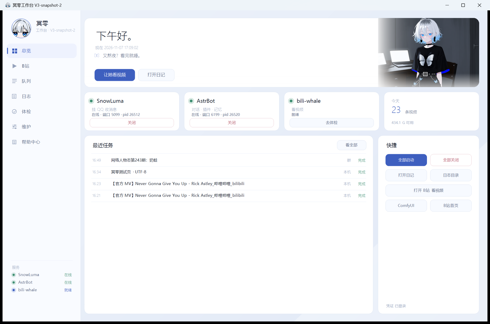

<div align="center">

# 冥零工作台 v2

一个 `MinglingWorkbench.exe`，把「QQ 聊天机器人」和「B 站看片」收进同一个窗口：
起停 SnowLuma / AstrBot、看今天的选题、丢一个 BV 进去让它自己看完、翻任务台账和日志。

原生 **Win32 + GDI+** 自绘，**不挂 Chromium / WebView2 / Electron**。一个进程、一个窗口，
重复双击只会把已有窗口提到前面。


[下载安装包](#-下载与使用) · [从源码编译](#-从源码编译) · [使用说明](docs/使用说明.md) · [变更记录](docs/CHANGES.md)

</div>

---

## 📖 项目简介

冥零工作台是一个**给单机机器人用的控制面板**，不是云端服务，也不依赖任何外部 IDE 或平台。

- **一切都在本机**：C++ 源码 + 一个只在本机跑的 Node sidecar。不登录、不上报、不收集数据。
- **一个 exe 管两件事**：左边管机器人（起停服务、看状态、修问题、导人设），右边管 B 站（选题、看完、出九宫格/字幕条/正文）。
- **没有浏览器内核**：界面是 GDI+ 自己画的，用系统自带的 DirectWrite/GDI 字体；冷启动是毫秒级，不是 Electron 的几秒。
- **不重造轮子**：B 站协议、wbi 签名、抽帧、字幕识别留在 sidecar 里（一个 Node CLI，MIT 许可），
  窗口只负责「给参数、读进度、展示结果、写台账」。上游修了 bug 换 sidecar 即可，不用重编 UI。

技术栈：C++17 / Win32 / GDI+ / WinHTTP，MinGW-w64 静态链接，Inno Setup 6 打包。

---

## ✨ 核心特性

### V2.2.0 新增

| 功能 | 说明 |
| --- | --- |
| **一键配置环境** | 维护页「一键自动配置」（或 `MinglingWorkbench.exe --bots-setup`）自动补 Node / ffmpeg / Python / Ollama，并把 AstrBot、SnowLuma、Breeze、Ollama、bili-whale **五个组件**装进 `<组件根>\<名字>\`，生成 `start-all.cmd` 与 `.setup.json` 安装报告。也可以脱离界面跑 `tools\auto-setup.ps1 -Workspace … -Bots … -Base …`。 |
| **冥零专属 Skill** | `plugin\mingling_skill\` 带人设模板与 AstrBot Skill 描述；维护页「导入冥零人设」把人设写进 AstrBot 的 `personas` 表、切好 `persona_id`、顺手改白名单前缀，并同步给桌宠。想换成自己的角色，只改 `{user_persona}` / `{user_tone}` 两段。 |
| **掉线提醒** | 后台心跳默认每分钟探一次 SnowLuma（5099）、AstrBot（6199）、Breeze（8137）；连**续两次**失败才算掉线，同一条 10 分钟内只提醒一次。提醒是右上角滑动横幅（带「重启一下」按钮）+ 托盘气泡，标题/正文/头像/频率都能在 `settings.json` 里改。 |
| **帮助页组件路径** | 帮助页直接列出工作区、台账、状态目录、组件根、AstrBot、SnowLuma、Breeze、Ollama 的绝对路径，配一个「组件目录」按钮，排错不用再猜装哪了。 |
| **求助页可改字** | 十一张求助卡每张都能「改文字」，改过的内容存进 `settings.json` 的 `custom_help_texts`，重装不丢。 |

### V2.3.0 新增

| 功能 | 说明 |
| --- | --- |
| **自设定（一键自动配置的第三段）** | 「一键自动配置」从两段变三段：补环境 → 装组件 → **自设定**。读 `pack\mingling-pack\pack.json` 的八个块（模型源 / QQ 平台 / 聊天设置 / 插件 / 长期记忆 / 语音 / 人设 / 验收），把 DeepSeek 源、`deepseek-flash` 模型、`冥零` 平台、13 项聊天设置、10 个插件、记忆与语音路线、人设一次配好，最后跑一遍只读验收。真改前自动快照到 `<机器人根>\private\snapshots\before-selfsetup-<时间>.json`，`-Restore` 可退回。命令行：`--selfsetup [--dry]`、`--her-op selfsetup [块…]`。 |
| **功能页** | 侧栏新增第 8 页「功能」，把配置包里默认关着的几样摆成开关：桌宠 petlink、唱歌 sing、豆包语音、在线 Breeze 语音，加上长期记忆（关 / 本机 bge-m3 / 硅基流动）和语音路线（关 / Edge / 豆包 / 本机 Breeze / 在线 Breeze）。点一下写进 `<机器人根>\private\`，再自动跑对应的自设定块接上；缺 key、缺音色会明说。 |
| **配置档案自动识别** | AstrBot 的「配置档案」与平台同名时，平台读的是同名档案（不是 default）。引擎、验收、人设注入都会先按 `pack.platform.id` 找同名档案，找不到才落 `default`；平台切到「冥零」也不会再写错档案。 |
| **白名单只加不删** | 人设注入原来会把白名单前缀整体重写（`大肥鱼:` 条目被删光导致 QQ 不回），现在保留所有平台的条目，只补当前人设前缀的副本。 |

> **V2.3.1 是补丁版**：组件目录统一认 `<工作区>\bots`——修掉「功能」页语音卡一直红、打游戏模式里 Breeze 关不掉也起不来、开机自启快捷方式还指老路径这几个问题。装过 V2.3.0 的覆盖装一遍就好，配置和记忆都不动。

> **V2.2.1 是补丁版**：修掉双击安装包报「错误 5：拒绝访问」的问题（根因是文件被标了低完整性，不是安装脚本），总览页不再放「打游戏模式」入口——它在维护页照样能用。

### 一直都有

- **十个页签**：总览 / B站 / 队列 / 日志 / 体检 / 维护 / 更新 / 功能 / 求助 / 帮助，`1`–`9` 直接跳，`0` 是帮助。
- **B 站一条龙**：今日选题 → 拉流 → 抽帧 → 字幕 → 九宫格 → 写正文，进度条分六个阶段。
- **任务台账**：工作台、QQ 群、模型工具调用写的是同一份 `logs\jobs.jsonl`，从哪看都是同一段历史。
- **维护页**：八张状态卡（大脑 / QQ / DeepSeek 余额 / 记忆 / 语音 / 看图看视频 / 开机自启 / 表情包）+ 一排一键动作（自动配置 / 重启大脑 / 重登 QQ / 导入人设 / 备份 / 求助 / 打开工作区 / 修自启 …）。
- **体检五连**：登录 → 依赖 → 限额 → 风控 → 自检，就是排错顺序本身。
- **更新页**：AstrBot / SnowLuma / 安装 Skill / 工作台四项版本对比；前三项给的是「复制给 Agent 的话」。
- **GUI 子系统但带 CLI**：`--paths`、`--feed`、`--watch BV…`、`--debrief`、`--bili <子命令>`、`--her-status` 都能在无桌面环境里跑。

---

## 🔧 从源码编译

只依赖 **MinGW-w64**（`g++` / `windres`）和 Windows SDK 头文件，不需要 CMake、MSVC、Qt、Node 或 ffmpeg。

### 0. 准备编译器

`g++` 不在 `PATH` 里时，二选一：

```bat
:: 方式 A：临时环境变量
set "MINGW_BIN=C:\mingw64\bin"
:: 方式 B：建一个不提交的本机覆盖文件 win32\build.local.bat
set "MINGW_BIN=C:\mingw64\bin"
```

`win32\build.bat` 的查找顺序是：`%MINGW_BIN%` → `win32\build.local.bat` → `PATH` 里的 `g++` / `windres`。

### 1. 拉取 sidecar 运行时（**必须先做**）

仓库里**不带** `node.exe` 和 `ffmpeg.exe`（体积太大，也不该进 Git）。第一次编译前先拉：

```bat
powershell -ExecutionPolicy Bypass -File tools\fetch-runtime.ps1
```

它会从 nodejs.org 取最新 LTS 的 `node.exe` 放到 `sidecar\node\node.exe`，
从 gyan.dev 取 ffmpeg essentials 放到 `sidecar\bili-whale\bin\ffmpeg.exe`。
已有文件不会覆盖；要重下加 `-Force`，要换镜像加 `-NodeExe <url>` / `-FfmpegExe <url>`。

### 2. 编译主程序

```bat
cd win32
build.bat
:: 产物：bin\MinglingWorkbench.exe（静态链接，约 1.2 MB）
```

`build.bat` 会先跑 `tools\check-version.ps1` 校验 `win32\src\version.h` 里的版本号与字符串一致，
再 `windres` 编资源、静态链接成单个 exe。构建前请先关掉正在运行的旧版本，否则覆盖 exe 会失败。

### 3. 打安装包

```bat
installer\build-installer.bat
:: 产物：dist\MinglingWorkbench-2.2.1-setup.exe
```

需要 **Inno Setup 6**（`ISCC.exe`）。仓库自带 `tools\innosetup6\app\ISCC.exe` 时直接用它，
否则请把它装进 `PATH`。脚本会先检查 `bin\`、`sidecar\node\node.exe`、
`sidecar\bili-whale\tools\bili.mjs`、`sidecar\bili-whale\bin\ffmpeg.exe` 是否齐，
再从 `version.h` 生成 `installer\version_auto.iss`，最后输出到 `dist\`。

> `dist\`、`bin\`、`sidecar\node\`、`sidecar\bili-whale\bin\*.exe` 都在 `.gitignore` 里，**不要提交**。

---

## ⬇️ 下载与使用

### 下载

到 [Releases](https://github.com/linyuehua0010/mingling-workbench/releases) 页面下载：

```
MinglingWorkbench-2.2.1-setup.exe      Windows 10/11 x64，约 51 MB
```

安装包**自带** `node.exe`、`ffmpeg.exe` 和 bili-whale，干净机器不用再装 Node / ffmpeg / Python / DSH。

### 安装

1. 双击安装包。默认装到 `%LOCALAPPDATA%\Programs\MinglingWorkbench`，**不需要管理员权限**。
2. 向导里选**工作区**。产物、台账、日志都落在这里，建议单独放一个盘，例如 `D:\冥零工作区`。
3. 勾选要不要桌面快捷方式。开始菜单会有「冥零工作台」和「卸载冥零工作台」。
4. 装完直接启动；第一次启动会确认工作区（安装时已选过就不再问）。

升级：直接覆盖安装，安装程序只在没有 `settings.json` 时才写工作区，已有设置不会被覆盖。
卸载：不删你的 `out\`、`tmp\`、`logs\`，也不删密钥目录。

### 装完之后

```bat
MinglingWorkbench.exe --paths
```

先核对这六行绝对路径（工作区 / 机器人根 / 组件根 / AstrBot / SnowLuma / Breeze / Ollama）。
机器人已经装在别处的，把 `%APPDATA%\MinglingWorkbench\settings.json` 里的 `base` 指过去即可：

```json
{
  "workspace": "D:\\冥零工作区",
  "base": "D:\\"
}
```

细节（人设、掉线提醒文案、求助卡文字、全部 settings 键）见 **[docs/使用说明.md](docs/使用说明.md)**。

工作台自身的更新检查走 GitHub Releases：在 `settings.json` 里写 `"repo": "linyuehua0010/mingling-workbench"`
才会去查；没写或仓库还没发版时显示「本机」，不会报错。

---

## 🔒 隐私与安全

**程序本身不收集任何数据**：没有遥测、没有崩溃上报、没有第三方统计，也不向作者的服务器发任何请求。
唯一的网络流量来自你自己配置的组件（AstrBot / SnowLuma / Breeze / Ollama）和 bili-whale 访问 B 站。

密钥和身份信息**只落在本机文件**里，不写注册表、不写系统临时目录：

| 内容 | 位置 |
| --- | --- |
| DeepSeek API Key | `<机器人根>\secrets\deepseek-key.txt` |
| AstrBot 后台账号 | `<机器人根>\secrets\backend.txt`（也接受 `private\backend.txt`） |
| SnowLuma 后台密码 | `<机器人根>\secrets\snowluma-webui.txt` |
| QQ 协议端类型 | `<机器人根>\secrets\protocol.txt` |
| 机器人 QQ 号 | `<机器人根>\private\bot-qq.txt`（界面里只显示打码形式 `12****34`） |
| B 站凭据 | `%USERPROFILE%\.bili-ai\credentials.json`（sessdata / bili_jct / buvid3） |

密钥目录可用 `%MINGLING_SECRETS%` 或 `settings.json` 的 `secrets` 键改到别处，重装/卸载都不会删。

### 提交代码前请务必确认

```bat
:: 这些文件永远不应该出现在仓库里
credentials.json          B 站 sessdata / bili_jct
secrets\  private\        密钥、后台密码、QQ 号、人设
.env  .env.*              任何环境变量文件
settings.json            本机工作区/机器人根路径
bili-whale.config.json    本机偏好与配额
bili-state\  logs\  out\  tmp\   运行状态与产物
```

自动检查：

```bat
git status --short
git ls-files | findstr /i "credentials secrets private .env settings.json bili-whale.config.json"
```

第二条**必须没有输出**。真实提交前再用 `git status --short` 过一遍，或者用
`git add -n .` 看一眼将要入库的文件清单。

如果凭据已经泄露：B 站重新登录换一份 `credentials.json`、DeepSeek 后台吊销并重建 Key、
AstrBot 后台改密码——**删除提交不够**，历史里还留着，得把 Key 作废。

---

## 🏗 它是怎么工作的

```
MinglingWorkbench.exe（Win32 + GDI+，无浏览器内核）
├── UI 线程           侧栏九个页签、自绘卡片、进度条、日志尾随
├── 工作线程          起停服务、跑 B 站任务、跑体检命令（结果用 PostMessage 回 UI）
└── sidecar\          只在本机跑的私有运行时，不依赖任何外部 IDE / 平台
    ├── node\node.exe               跑 bili-whale 的 Node 运行时
    └── bili-whale\                 看 B 站的实现（MIT，见 docs/THIRD-PARTY.md）
        ├── tools\bili.mjs          CLI：feed / debrief / session / quota / traffic / deps / selftest
        └── bin\ffmpeg.exe          抽帧、抽音频、拼九宫格和字幕条
```

窗口不实现 B 站协议，也不在 C++ 里重写 wbi 签名、字幕、抽帧——签名和解析留在 sidecar 里，
工作台只负责：给参数、读进度、展示结果、写台账。

工作台给 sidecar 传的是一组明确的环境变量：

| 变量 | 含义 |
| --- | --- |
| `BILI_ROOT` | 当前工作区 |
| `BILI_OUT_ROOT` / `BILI_TMP_ROOT` / `BILI_LOGS_ROOT` | 工作区下的 `out` / `tmp` / `logs` |
| `DSH_HOME` | 状态目录（日记、quota、作息），不是 `~/.dsh` |
| `BILI_WHALE_CONFIG` | 工作台的 bili-whale 配置文件 |
| `FFMPEG` | 安装包自带的 `ffmpeg.exe` |

---

## 🖼 界面



| 页 | 截图 |
| --- | --- |
| B 站（选题 / 看完） | [选题](docs/screens/bili-feed.png) · [结果](docs/screens/bili-result.png) |
| 队列 / 体检 | [队列](docs/screens/jobs.png) · [体检](docs/screens/check.png) |
| 维护 / 帮助 | [维护](docs/screens/maint.png) · [帮助](docs/screens/help.png) |
| V2.2.0 新界面 | [侧栏与维护页](docs/screens/v2.2.0-sidebar.png) · [帮助页路径](docs/screens/help-paths.png) |

截图来自一台没有装 DSH 的隔离环境（`docs/ACCEPTANCE.md` 第 3 节有说明）。

---

## 📑 九个页签

| # | 页签 | 能做什么 |
| --- | --- | --- |
| 1 | 总览 | SnowLuma / AstrBot 起停、今天看了几条、磁盘剩余、最近任务、快捷入口 |
| 2 | B站 | 今日选题、输入 BV/链接看视频、进度、封面/九宫格/字幕条、复制全文、打开产物目录 |
| 3 | 队列 | `logs\jobs.jsonl` 的任务记录：时间、BV、标题、UP、来源、状态、耗时、正文 |
| 4 | 日志 | SnowLuma / AstrBot / B 站三路日志，2.5 秒尾随，可刷新、开日志目录 |
| 5 | 体检 | 登录、依赖、限额、风控、自检五条命令，原样显示 sidecar 输出 |
| 6 | 维护 | 八张状态卡、两个频率（掉线提醒 / 打游戏）、一排一键动作（一键自动配置 / 重启大脑 / 重登 QQ / 导入冥零人设 / 备份 / 求助 / 开语音 / 开 Ollama / 打开工作区 / 修自启 / 更新技能 / 打开日志） |
| 7 | 更新 | AstrBot、SnowLuma、安装 Skill 和工作台四项的本地版本 vs 最新版 |
| 8 | 求助 | 十一张常见问题卡，点一下就把「该对 Agent 说的话」复制到剪贴板，卡片文字可改 |
| 9 | 帮助 | 使用 FAQ、快捷键、组件绝对路径与「组件目录」按钮 |

### B 站页

- **今晚看什么**：调 `feed`，按你的偏好、看过名单、当天配额挑几条。点一条会填进输入框，
  也可以直接粘 BV 号或 `https://www.bilibili.com/video/BV...` 链接。
- **看视频**：跑 `debrief <BV> --grid 3x3`。进度条按 ① 拉流 → ② 看画面 → ③ 字幕 →
  ④ 拼图 → ⑤ 写正文 → ⑥ 收尾推进，同时显示「正在看 BV… · 阶段 · 秒数」。
- 结果区是 sidecar 写的正文，可直接**复制全文**；封面、九宫格、字幕条可以点开；
  **打开产物目录**直接开 `<工作区>\out\<BV>\`。
- 每次看完都会写一条台账：`source=console`、`chat=工作台`，正文存 `logs\jobs\<BV>-<时间戳>.txt`。

### 快捷键

| 键 | 作用 |
| --- | --- |
| `1` … `9` | 切到第 1…9 个页签 |
| `F5` | 刷新当前页（B 站选题 / 队列 / 日志） |
| `F9` | 启动 SnowLuma + AstrBot |
| `F10` | 停掉 SnowLuma + AstrBot |
| `Esc` | 让输入框失焦 |
| `Enter`（输入框里） | 开始看当前 BV |
| 再双击 exe | 不会多开，只把已有窗口提到最前 |

---

## 📂 工作区与产物路径

所有看 B 站产生的东西都在工作区里，**不会写 `~/.dsh`、DSH profile 或系统临时目录**：

```
<工作区>\
├── out\
│   └── BV1xxxxxxxxx\
│       ├── cover.jpg                       封面
│       ├── BV1…-<时间>-3x3.jpg             九宫格
│       ├── BV1…-<时间>-subs.jpg            字幕条
│       ├── BV1…-<时间>.mp4                 原片（看完即留，可手动清）
│       └── BV1…-debrief.txt                正文缓存
├── tmp\                                    中间帧，抽完立即回收，正常情况下是空的
├── logs\
│   ├── jobs.jsonl                          台账（工作台 + QQ 插件共用）
│   └── jobs\
│       └── BV1…-<unix>.txt                 每次任务的正文
└── bots\                                   v2.2.0：一键配置默认把组件装这里
    ├── AstrBot\  SnowLuma\  Breeze\  Ollama\  bili-whale\
    ├── start-all.cmd                       一键全起
    └── .setup.json                         这次装了什么、成没成功
```

状态与凭据（可以备份、可以随机器迁移）：

| 内容 | 位置 |
| --- | --- |
| 工作区/机器人根设置 | `%APPDATA%\MinglingWorkbench\settings.json` |
| bili-whale 配置（偏好、配额、作息） | `%APPDATA%\MinglingWorkbench\bili-whale.config.json` |
| 日记、quota、作息状态 | `%APPDATA%\MinglingWorkbench\bili-state\` |
| B 站凭据（工作台与插件共用） | `%USERPROFILE%\.bili-ai\credentials.json` |
| 程序本体 | `%LOCALAPPDATA%\Programs\MinglingWorkbench\` |

换电脑：把工作区整个拷走，再把 `%APPDATA%\MinglingWorkbench` 和 `%USERPROFILE%\.bili-ai`
一起带过去，最后在新机器上用「换工作区」指过去即可。

---

## ⌨️ 命令行自检

工作台是 GUI 子系统，但带了一组不需要开窗口的自检命令（输出同时写 `MINGLING_CLI_OUT` 指定的文件）：

```bat
MinglingWorkbench.exe --paths                 :: 工作区、机器人根、组件根、sidecar、node、ffmpeg、凭据、台账
MinglingWorkbench.exe --feed                  :: 跑一次今日选题
MinglingWorkbench.exe --watch BV1xxxxxxxxx    :: 完整看一条，并写台账（source=console）
MinglingWorkbench.exe --debrief BV1xxxxxxxxx  :: 只看 sidecar 的 debrief 输出
MinglingWorkbench.exe --bili session          :: 把任意 bili-whale 子命令原样转发
MinglingWorkbench.exe --her-status            :: 机器人状态（维护页同款）
MinglingWorkbench.exe --bots-setup            :: 一键配置环境（维护页同款）
```

`--watch` 与界面走完全相同的契约：同一套环境变量、同一个 `out\<BV>\`、同一份 `jobs.jsonl`。

---

## 🩺 排错

| 现象 | 先看哪里 | 处理 |
| --- | --- | --- |
| B 站页说「没找到内置 B站组件」 | `--paths` 的 sidecar 行 | 安装不完整，重装；或设置 `MINGLING_SIDECAR` |
| 看片卡在 ① 或报凭据过期 | 体检页 `session` | 重新导出 `.bili-ai\credentials.json`（见 [docs/deploy-bili.md](docs/deploy-bili.md)） |
| 九宫格出不来 / 抽帧失败 | 体检页 `deps` | 确认安装目录里 `sidecar\bili-whale\bin\ffmpeg.exe` 在；重装可恢复 |
| 产物跑到别处 | B 站页底部的工作区路径 | 用「换工作区」改回来；`--paths` 复核 |
| 群里能看、工作台不能看 | `--paths` 的凭据与配置 | 两边必须指向同一个工作区和同一份凭据 |
| 服务起不来 | 日志页对应日志 | AstrBot 需要 `<机器人根>\astrbot` 与 `astrbot.exe`；SnowLuma 需要 `<机器人根>\SnowLuma\node.exe` |
| 维护页全红 | `--paths` 的机器人根 | `base` 指错了，组件是在 `<base>\bots\` 和老平铺目录里找的 |
| 一键配置装到一半失败 | `<组件根>\.setup.json` | 里面记了每个组件的成功/失败与原因 |
| 窗口不出现 | 任务管理器 | 已有实例被最小化到托盘区？再双击 exe 会置前；单实例靠窗口类名 |

更多：QQ 机器人部署见 [docs/deploy-qq.md](docs/deploy-qq.md)，
看 B 站插件部署见 [docs/deploy-bili.md](docs/deploy-bili.md)。

---

## 🗂 目录结构

```
win32\src\             C++ 源码（main / ui / whale / paths / util / her）
win32\res\             图标、manifest、rc
win32\build.bat        编译主程序（产物到 bin\）
sidecar\               node.exe + bili-whale + ffmpeg（不提交，fetch-runtime.ps1 拉取）
plugin\astrbot_plugin_bili_bridge\   AstrBot 插件（群里看 B 站）
plugin\mingling_skill\ 冥零的人设模板与 Skill 描述
installer\             Inno Setup 脚本与打包脚本
docs\                  部署教程、第三方声明、验收记录、变更清单、截图
tools\                 sidecar 补丁、运行时抓取、一键配置、版本自检
art\                   avatar.png / hero.png
```

---

## 📄 许可与致谢

- 第三方组件（bili-whale、ffmpeg、Node.js 等）的许可证与出处全部列在 [docs/THIRD-PARTY.md](docs/THIRD-PARTY.md)。
- 主程序源码的开源许可证见仓库根目录的 [LICENSE](LICENSE)。
- 这次重构改了什么、为什么这么选，见 [docs/CHANGES.md](docs/CHANGES.md)；验收记录见 [docs/ACCEPTANCE.md](docs/ACCEPTANCE.md)。
