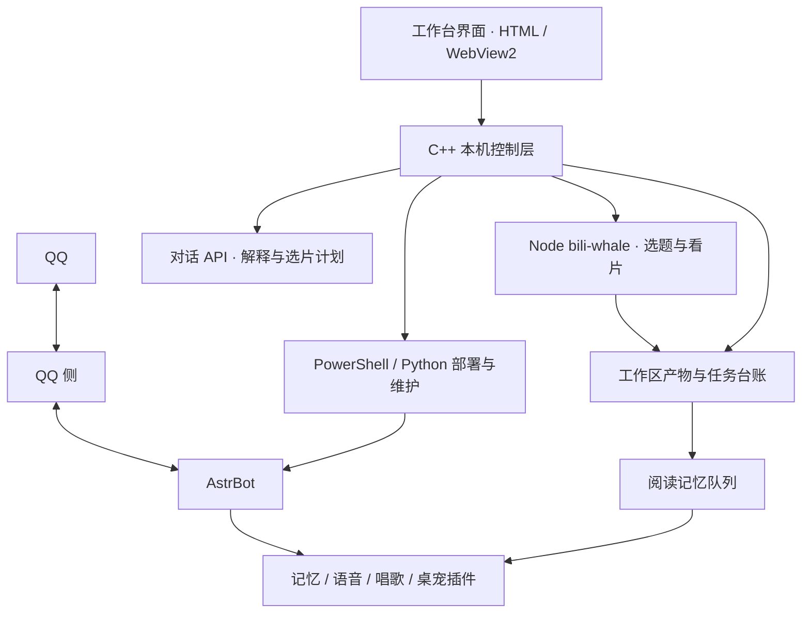

# MinglingWorkbench 项目总览

> 状态日期：2026 年 11 月 10 日。本文基于当前本地源码、构建产物、项目文档与本次验证结果整理；不代表所有功能均已完成端到端验收。

## 1. 项目定位

MinglingWorkbench（冥零工作台）是一套在 Windows 本机运行的冥零控制台，集中管理 QQ 对话、看片读网页、长期记忆、语音、唱歌和桌宠。

当前版本是 **V3.2.0**。项目已形成可在本机使用的基础能力，开发重点逐步转向功能串联、稳定性和发布验收。

工作台采用 **C++17 / Win32 + WebView2 内嵌 HTML**。页面与角色图片编进 exe，界面离线加载，不为工作台界面开放本机 HTTP 服务。对话、B 站和部分语音能力会使用相应网络服务。

## 2. 版本与交付状态

| 项目 | 当前情况 |
|---|---|
| 本地源码与运行程序 | **V3.2.0**，使用正式通道目录 |
| 本地发布记录 | V3.1.0 已发布；V3.2.0 已出包（`dist/MinglingWorkbench-3.2.0-setup.exe`） |
| V3.2.0 安装包 | `dist/` 中已生成；带内置组件包的那版文件名多一个后缀（见 [VERSIONING.md](VERSIONING.md)） |
| Git 状态 | 本轮文档纠错与界面优化尚未提交（见 `git status`） |
| 安装技能 | `mingling-install` **0.5.0** |

版本以 [version.h](../win32/src/version.h) 为准，开发记录见 [CHANGES.md](CHANGES.md)，版本与渠道规则见 [VERSIONING.md](VERSIONING.md)。

## 3. 功能版图

| 模块 | 已有能力 | 当前边界 |
|---|---|---|
| 工作台界面 | 七页导航、三种主题、状态展示、任务详情、配置面板 | Windows 桌面运行，主界面依赖 WebView2 |
| QQ 对话 | AstrBot 大脑、QQ 接入、DeepSeek、人设导入、回复习惯配置 | 依赖相关组件和账号登录 |
| 部署与维护 | 补环境、八块自设定、起停组件、体检、日志、备份、更新、自启 | 复杂功能由脚本与各组件共同完成 |
| B 站与网页 | 今日选题、视频字幕与抽帧、九宫格、网页正文读取、API 补充解释 | 网页读取有超时和大小限制 |
| B 站自主安排 | API 选片、安排时间、串行观看、定时刷新、停止与恢复 | 每轮最多三条，工作台需保持运行 |
| 长期记忆 | QQ 记忆、阅读结果排队写入、失败重试、本机或云端嵌入模型 | 阅读队列需 AstrBot 与记忆插件处理 |
| 语音与唱歌 | Edge、豆包、本机及在线 Breeze；豆包唱歌、SoulX 本地唱歌配置与部署 | 各路线需要独立验证；SoulX 当前生成人声 |
| 桌宠互通 | 人设同步、QQ 与桌宠桥接、最近消息范围和连接检测 | 需另装 DSH 桌宠并完成桥接 |

### 七个页面

| 页面 | 主要用途 |
|---|---|
| 总览 | 服务状态、消息与记忆统计、最近任务、快捷入口 |
| 一起看看 | 今天看啥、丢个链接、看完了、B 站与 API 配置 |
| 做过的事 | 任务台账与正文详情 |
| 日志 | 查看组件运行日志 |
| 哪儿卡了 | B 站登录、依赖、限额、风控与自检 |
| 照顾她 | 组件与操作、相处习惯、功能配置、主题 |
| 帮帮忙 | 教程、更新检查、求助信息 |

### 八块自设定

`provider`（模型）→ `platform`（QQ 平台）→ `chat`（聊天习惯）→ `plugins`（插件）→ `memory`（记忆）→ `voice`（语音）→ `persona`（人设）→ `verify`（验收）。

## 4. 整体架构

### 两条模型调用路径

- **QQ 对话**：QQ 侧收发消息，AstrBot 组织上下文、人设、插件和模型调用。
- **工作台 API**：“问一句”和 B 站任务安排直接调用工作台配置的 OpenAI 兼容 API。

因此，工作台 API 测试和选片不要求先启动 AstrBot；阅读结果写入长期记忆需要 AstrBot 与对应插件运行。两条路径有各自的配置与上下文，接入同一模型服务不意味着自动共享聊天历史。

### 阅读到记忆的数据流

1. 工作台或 QQ 插件触发看片、读网页。
2. 产物写入 `out/`，观看或阅读记录写入 `logs/jobs.jsonl`。
3. 成功结果进入 `logs/memory-inbox/` 队列。
4. `astrbot_plugin_bili_bridge` 处理队列并写入长期记忆；失败任务保留重试。

## 5. 代码与数据分布

| 目录 | 职责 |
|---|---|
| `win32/` | C++ 主程序、WebView2 界面、原生业务逻辑与测试 |
| `sidecar/` | bili-whale、Node、ffmpeg |
| `tools/` | 安装、自设定、诊断、备份及桥接脚本 |
| `pack/` | 自设定配置包与配套 AstrBot 插件 |
| `plugin/` | 冥零人设、Skill 描述与 B 站桥接插件 |
| `skill/` | 给 Agent 使用的安装、修复与部署技能 |
| `installer/` | Inno Setup 安装包构建 |
| `docs/` | 使用说明、部署文档、变更与验收记录 |
| `bots/` | 本机组件与模型 |
| `bin/` | 编译后的工作台与 WebView2 Loader |
| `dist/` | 安装包、源码包和发布校验文件 |
| `out/` | 视频、图片、字幕和阅读产物 |
| `logs/` | 日志、任务台账、阅读记忆队列、B 站任务计划 |
| `private/`、`secrets/` | 本机配置、账号凭据和密钥 |
| `旧版/` | 升级与配置修改前的备份 |

工作台自身设置保存在 `%APPDATA%/MinglingWorkbench/`。B 站凭据沿用 `%USERPROFILE%/.bili-ai/credentials.json`。

## 6. 本轮新增与修复

### B 站 API 自主安排

- 在“今天看啥”增加“API 安排一轮”“开启自动安排”“停止安排”。
- 模型从已知候选中选片，给出观看时间和下次刷新时间。
- 工作台校验计划，拒绝未知视频、重复任务和无效时间。
- 每轮最多三条，并受配置中的观看数量、每日安排次数与作息窗口限制。
- 观看串行执行；停止后取消待看任务，正在看的任务正常完成。
- 观看失败结束本轮；自动模式至少等待一小时再安排，并继续受每日次数限制。
- 计划保存在 `logs/bili-plan.json`；重启后中断任务不自动重做，超过一天的待看任务取消。

### API 连接测试

- 测试使用当前表单填写的参数，不再只测试旧配置。
- 测试进度与结果实时更新，同时保留未保存的表单。
- 支持接口根地址或完整的 `/chat/completions` 地址，避免重复拼接路径。
- 展示更具体的服务端错误，并隐藏错误信息中可能出现的密钥。

### 今日选题刷新

- “换一批”跳过搜索缓存，并排除当前一批候选。
- 选题排除工作台台账中已成功观看的视频。
- 刷新失败时保留上一批，并显示失败原因。

具体使用方法见 [API 自动安排 B 站观看](bili-auto.md)。

### 安装与环境自动化

- 组件清单 `tools/components.json`：每个组件写清 `id / version / requires / detect / source(sha256) / install / verify / optional / manual`。
- 安装引擎 `tools/bootstrap.ps1`：按 `requires` 拓扑排序，逐个「检测 → 安装 → 验证」；已满足就跳过，失败重跑只补缺项。
  支持 `-Check`（只检测，缺项退出码 2）、`-Component`、`-Offline`、`-Proxy`、`-IncludeOptional`、`-Force`。
- 下载统一走 SHA256 校验与镜像回退；状态写 `<工作区>\logs\setup\state.json`，日志写同目录并按行脱敏；
  路径含中文和空格按字面处理，默认用户级安装、不要求管理员。
- 工作台「一键自动配置」、`--autosetup` / `--bots-setup`、安装器收尾体检、`mingling-install` 技能、
  旧 `tools/auto-setup.ps1`（转发壳）都调这一份脚本，不再各写一套下载逻辑。
- 八块自设定保留 apply/verify 双路径：`tools/self-setup.ps1 -Verify` 只读核对，不 PUT、不拍快照、不写文件。
- 用法、参数、清单格式与已知限制见 [安装与环境自动化](setup-automation.md)。

## 7. 已确认的验证结果

以下为本轮实际执行的检查，范围不等同于整个项目的完整验收：

- 工作区版本编译成功，已替换并重新打开 `bin/MinglingWorkbench.exe`。
- DeepSeek 连接测试真实成功，返回“你好，很高兴见到你！”。
- “今天看啥”真实刷新出了新的六条候选。
- 18 项界面回归测试通过。
- 选题刷新与缓存绕过测试通过。
- API 请求与任务计划校验测试通过。
- 任务生命周期测试通过，覆盖串行执行、等待 API 总结、停止、失败、去重、作息限制、保存失败与重启中断处理。

状态截点上，**B 站自动模式尚未开启**。本轮未执行所有语音、唱歌、桌宠和长期记忆路线的端到端验收。

历史安装与隔离环境验证可参考 [ACCEPTANCE.md](ACCEPTANCE.md)；该文档记录的是历史版本，不能直接作为当前版本的完整验收结论。

## 8. 当前阶段与下一步

V3.2.0 已出包（`dist/MinglingWorkbench-3.2.0-setup.exe`）。接下来的工作：

1. **完成端到端验收**：分别验证唱歌、桌宠、各语音路线和阅读记忆写入，保留可复现的结果。
2. **文档与版本描述已对齐 V3.2.0**：README、使用说明、部署教程、版本规范、安装技能均已同步；
   新增的 [deploy-qq.md](deploy-qq.md) 整篇按
   `tools\components.json` + `tools\bootstrap.ps1` 的现行架构重写。
3. **整理未提交改动**：按功能与修复拆分检查。
4. **验证安装与升级**：在干净环境测试首次安装，再验证从旧正式版升级时配置、记忆、凭据与产物的保留情况。

## 9. 相关文档

- [项目 README](../README.md)
- [使用说明](使用说明.md)
- [变更记录](CHANGES.md)
- [版本与渠道规则](VERSIONING.md)
- [内嵌 HTML 界面](ui-html.md)
- [QQ 部署](deploy-qq.md)（一键装、端口、接到 AstrBot、排错）
- [B 站桥接部署](deploy-bili.md)
- [安装与环境自动化](setup-automation.md)
- [API 自动安排 B 站观看](bili-auto.md)
- [语音、唱歌与桌宠功能说明](她会做的事.md)
